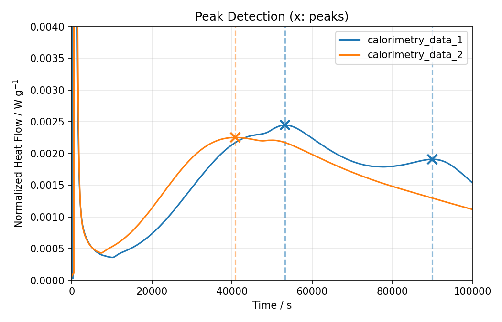
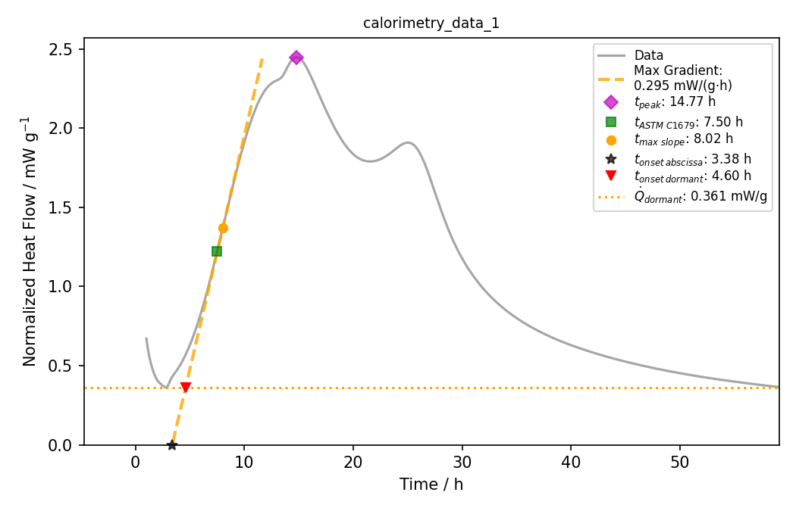
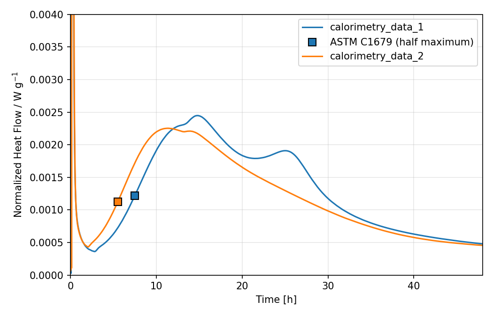

# Characteristic Values

CaloCem extracts characteristic values from the heat flow curves. Every
method returns a pandas DataFrame with one row per sample (or per peak),
which can be saved with `to_csv` or merged with your metadata.

| Quantity | Method |
|---|---|
| Cumulative heat at a given age | `get_cumulative_heat_at_hours` |
| Heat released between two times, e.g. up to the onset | `get_heat_between` |
| Peaks (time, height, prominence) | `get_peaks` |
| Minimum heat flow of the dormant period | `get_dormant_period_heatflow` |
| Main hydration peak: slopes, onset, peak | `get_mainpeak_params`, see [Main Peak Parameters](example_get_mainpeak_params.ipynb) |
| ASTM C1679 half-maximum point | `get_astm_c1679_characteristics` |
| Onset by gradient threshold | `get_peak_onsets` |
| Peak deconvolution | `get_deconvolution` |

All examples below assume a loaded `Measurement` and processing parameters:

```python
from pathlib import Path

import matplotlib.pyplot as plt

from calocem import Measurement, ProcessingParameters

datapath = Path(__file__).parent / "calo_data"
tam = Measurement(folder=datapath, show_info=False)

processparams = ProcessingParameters()
```

Times are given in seconds, heat flows in W/g and heats in J/g.

## Cumulative heat

```python
processparams.cutoff.cutoff_min = 0
heat_24h = tam.get_cumulative_heat_at_hours(processparams, target_h=24)
```

The result has the columns `sample`, `cumulative_heat_j_g` (J/g),
`target_h` and `cutoff_min`.

!!! warning "Effect of the cutoff"
    The heat released before `cutoff.cutoff_min` is **subtracted**. With the
    default cutoff of 60 min, the result is the heat released between 1 h
    and `target_h`. Set `cutoff_min = 0` to get the total heat since the
    start of the measurement.

!!! note "Renamed in 0.4.0"
    `get_cumulative_heat_at_hours` was called `get_cumulated_heat_at_hours`,
    and `cumulative_heat_j_g` was called `cumulated_heat_at_hours`. The old
    method and column still work but are deprecated.

## Heat between two times

`get_heat_between` returns the heat released between `start_s` and `end_s`.
The cumulative heat is interpolated at both times, and the cutoff has no
effect. Each limit is either one time for all samples or one time per
sample, given as a dict or `pd.Series` keyed by `sample_short`. This way
you can integrate up to the onset of the main peak, which differs per
sample:

```python
onsets = tam.get_mainpeak_params(processparams).set_index("sample_short")

heat_to_onset = tam.get_heat_between(
    start_s=1800,  # 30 min
    end_s=onsets["onset_time_s_from_max_slope"],
)
```

The result has the columns `sample`, `sample_short`, `start_s`, `end_s` and
`heat_j_g` (J/g). Any other time column works as well, e.g.
`onset_time_s_from_mean_slope`, `dorm_time_s` or `peak_time_s`. The heat is
NaN if a sample has no time, a time lies outside the data, or `end_s` is
before `start_s`.

## Peaks

Peaks are searched with
[`scipy.signal.find_peaks`](https://docs.scipy.org/doc/scipy/reference/generated/scipy.signal.find_peaks.html)
after the cutoff. The `peakdetection` parameters control the sensitivity;
a smaller `prominence` finds smaller peaks.

```python
processparams.cutoff.cutoff_min = 60
processparams.peakdetection.prominence = 1e-4

fig, ax = plt.subplots()
peaks = tam.get_peaks(processparams, show_plot=True, ax=ax)
ax.set_xlim(0, 100000)
ax.set_ylim(0, 0.004)  # hide the initial heat flow spike
plt.show()
```



`peaks` contains the data row at each peak (`time_s`,
`normalized_heat_flow_w_g`, `normalized_heat_j_g`, ...) plus the
`prominence` and the number of the peak per sample (`peak_nr`, starting at
0). It can be exported, e.g.

```python
peaks[["sample_short", "time_s", "normalized_heat_flow_w_g", "prominence"]].to_csv(
    "peaks.csv", index=False
)
```

!!! note
    `show_plot` defaults to `True` for `get_peaks`. Pass `show_plot=False`
    when you only need the table.

## Dormant period

The dormant (induction) period is characterized by the minimum heat flow
between the cutoff and the first detected peak:

```python
dormant = tam.get_dormant_period_heatflow(processparams)
```

Columns: `dorm_time_s`, `normalized_heat_flow_w_g_dormant` and
`normalized_heat_j_g_dormant`. Samples without a detected peak are missing
from the result.

## Main hydration peak

The slopes of the main (silicate) peak and the onset of the acceleration
period are determined by `get_mainpeak_params`:

```python
processparams.spline_interpolation.apply = True
processparams.spline_interpolation.smoothing_1st_deriv = 1e-13
processparams.plotting.time_unit = "hours"
processparams.plotting.heat_unit = "mW"

mainpeak = tam.get_mainpeak_params(processparams, show_plot=True, plot_type="max")
```



It combines

* the **maximum slope**: the maximum of the (smoothed) time derivative of the
  heat flow, with its time and value,
* the **mean slope**: a tangent averaged over the ascending flank of the main
  peak,
* the **onset** times, where these tangents intersect the dormant heat flow
  or the time axis,
* the dormant period and ASTM C1679 values described on this page.

Since the derivative of measured data is noisy, smoothing (see
[Processing Parameters](processing-parameters.md#smoothing)) usually
improves the maximum slope. Too much smoothing flattens the peak and
underestimates the slope, so compare the tangent with the curve in the plot.
The
[Main Peak Parameters](example_get_mainpeak_params.ipynb) tutorial explains
all options and the returned columns.

`get_maximum_slope` and `get_average_slope` return only the maximum slope or
only the mean slope columns of the same analysis.

## ASTM C1679

The standard ASTM C1679 characterizes the main
peak by the time at which the heat flow reaches half of the peak maximum on
the ascending flank:

```python
fig, ax = plt.subplots()
astm = tam.get_astm_c1679_characteristics(
    processparams, show_plot=True, xunit="h", ax=ax
)
ax.set_xlim(0, 48)
ax.set_ylim(0, 0.004)
plt.show()
```



Columns: `astm_time_s`, `normalized_heat_flow_w_g_astm` and
`normalized_heat_j_g_astm`. With `individual=False`, the half of the mean
peak height of all samples is used as common threshold.

## Onset by gradient threshold

`get_peak_onsets` returns the first time at which the gradient of the heat
flow exceeds `gradient_threshold` (in W/g/s):

```python
onsets = tam.get_peak_onsets(gradient_threshold=1e-8, rolling=10)
```

!!! note
    This method does not use the processing parameters. Data before
    `time_discarded_s` (default 900 s) is ignored instead of
    `cutoff.cutoff_min`. The default `gradient_threshold` of 5e-4 W/g/s is
    too high for typical cement pastes; values around 1e-8 W/g/s are a
    better starting point.

## Peak deconvolution

Overlapping reactions, e.g. the silicate and the aluminate peak, can be
separated by fitting the heat flow after the cutoff as a sum of peaks plus a
baseline:

```python
processparams.cutoff.cutoff_min = 30
deconv = tam.get_deconvolution(
    processparams,
    n_peaks=2,
    peak_shape="lognormal",  # or "gaussian"
    baseline_mode="constant",  # "linear", "chebyshev" or "none"
    show_plot=True,
)
```

The result has one row per fitted component with its `amplitude` (W/g),
`peak_time_s`, `width`, `component_area` (J/g) and `component_area_fraction`,
together with the fit quality (`fit_r2`, `fit_rmse`) and the baseline
coefficients. Fit settings are collected in the
[deconvolution parameters](processing-parameters.md#deconvolution).

!!! tip
    Check the plot: a component with an amplitude close to zero means that
    fewer peaks describe the data equally well. Its `peak_time_s` is then
    meaningless.

`get_left_peak_inflection_tangent_intersection` uses the fit to determine an
onset of the first peak: the tangent at the inflection point of its left
flank is intersected with the time axis (`x_intersection_abscissa_s`). Pass
the result of `get_deconvolution` as `deconvolution_results` to avoid fitting
twice.
